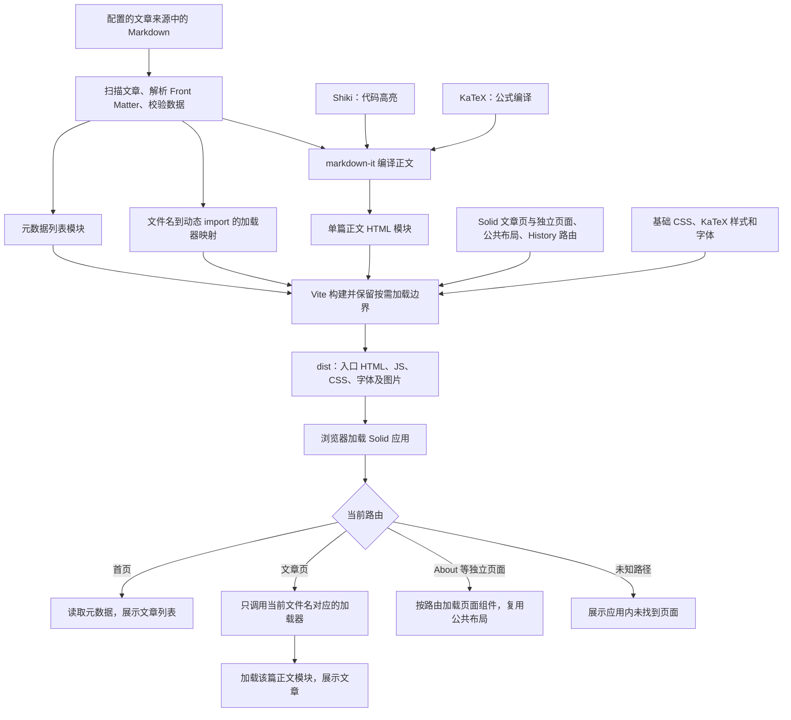

# 博客重构项目构建与实施计划

编写日期：2026-11-17

更新日期：2026-11-18（技术栈切换为 Solid）

文档状态：阶段一已按 Solid 技术栈完成并通过验收（2026-11-18）。阶段二已完成元数据实现与生产构建接入，测试暂缓。阶段三至五待实施。2026-11-17 的 Vue 版验收保留为历史记录。

适用方式：本计划可独立转交到其他环境执行，不指定新项目的仓库名称或本地路径。目录结构、文件命名和模块落点在实施时确定；本文约束的是功能范围、职责边界与验收标准。

## 1. 项目来源与目标

### 1.1 参考原项目

- 原项目 Git 地址：`git@github.com:WeizhongQiu/blog-magic.git`
- 原项目网页：[WeizhongQiu/blog-magic](https://github.com/WeizhongQiu/blog-magic)
- 参考代码可通过上述仓库获取，不要求执行环境预先存在某个本地副本。
- 原项目分析来自编写计划时已查看的代码；实施前应确认实际参考的提交，不假定其与远端最新提交完全一致。

原项目已使用 Vue、Vite、markdown-it、Shiki、KaTeX 和 gray-matter，可参考其文章渲染思路和现有内容。新项目重新组织代码和依赖，先实现最小可用的博客框架。

需要重点改进的地方：

| 原项目情况                                                       | 新项目处理方式                                    |
| ---------------------------------------------------------------- | ------------------------------------------------- |
| 原项目的文章加载与路由模块混合文章读取、路由、分类和搜索初始化   | 内容编译、路由和页面展示分别负责                  |
| 初始化时通过 `Promise.all` 调用所有文章加载函数，之后才创建路由  | 路由立即可用，正文按篇加载，首页只读取元数据      |
| 原项目的 Markdown 渲染模块同时处理正文、高亮、代码行号和复制按钮 | 第一阶段只保留正文、高亮和公式渲染                |
| KaTeX 样式通过嵌套 `node_modules` 路径引入                       | 将 KaTeX 声明为直接依赖，使用公开的包路径引入样式 |
| 样式、动画、搜索、主题及状态管理依赖较多                         | 只添加当前阶段需要的依赖                          |

### 1.2 本阶段目标

完成一个使用 Solid TSX 组件展示、以 Markdown 为内容来源的博客单页应用：

1. 使用 pnpm 和 Vite 建立项目。
2. 使用 Solid 1.x、TypeScript 和基于浏览器 History API 的 Solid Router。
3. 在开发服务端或生产构建阶段完成 Markdown、代码高亮和公式编译。
4. 首页展示文章列表，文章页按需加载正文；加入正文留空的 About 页面。
5. 支持本地开发、文章变更自动刷新、类型检查和生产构建。
6. 形成清晰的模块职责、文章约定和验证方法，支持继续增加独立页面；具体目录在实施时安排。

## 2. 已确定的边界

### 2.1 当前必须遵守的决定

- 使用 Solid（`solid-js`），以现有 Solid 1.x 工程为基线，不使用 Vue、React 或 Nunjucks。
- 使用 `@solidjs/router` 的浏览器 `<Router>`，通过 History API 导航，不使用 `HashRouter`。
- 使用标准 `vite build` 构建浏览器应用，不引入 SolidStart 或预渲染框架，不要求 SSR 或 SSG。
- **所有当前实现阶段均不考虑 GitHub Pages 部署问题。** 不添加部署工作流、部署专用路径规则、`404.html` 回退或按文章复制入口 HTML 的逻辑。
- 本地服务从根路径运行，Vite 使用默认 `base: '/'`。
- GitHub Pages 适配方案不属于本计划的实施内容。未来有明确部署需求时，再单独设计。

本阶段属于“静态资源构建 + 浏览器端 Solid 渲染”。正文虽然在构建时已转换成 HTML 字符串，但每篇文章不会被预渲染成独立的完整 HTML 页面。

### 2.2 功能范围

| 本阶段实现                                            | 暂缓实现                                      |
| ----------------------------------------------------- | --------------------------------------------- |
| 首页文章列表、文章页、About 页面、应用内未找到页面    | 搜索、分类页、标签页、归档页、分页            |
| 标题、日期、摘要等文章信息                            | 自动摘要、字数统计、阅读时长                  |
| 基础 Markdown、代码高亮、行内及块级公式               | Markdown 主题、夜间模式、目录、代码复制、行号 |
| 简单页头、页脚、首页与 About 导航、内容宽度和溢出处理 | 动画、复杂响应式导航、UI 组件库               |
| 通过独立 Solid 页面、路由记录和导航配置扩展页面       | 自动生成页面路由、通用页面插件系统            |
| 文章新增、修改、删除后的开发刷新                      | Markdown 内嵌 Solid/JSX、MDX、通用插件市场    |
| 构建检查、核心内容逻辑测试                            | 部署适配、完整 SEO、RSS、站点地图             |

不做 Markdown 视觉主题，但保留 Shiki 高亮输出以及 KaTeX 正常显示所需的 CSS 和字体。第一阶段使用 Solid 自带的响应式原语，不引入额外状态管理库。

## 3. 技术栈与依赖管理

| 技术                           | 职责                                   | 使用约定                                                     |
| ------------------------------ | -------------------------------------- | ------------------------------------------------------------ |
| pnpm                           | 安装依赖和运行项目命令                 | 提交 `pnpm-lock.yaml`，记录确切的 pnpm 版本                  |
| Node.js                        | 运行 Vite 和内容编译逻辑               | 实施时选择工具链共同支持的 LTS 版本并记录                    |
| Vite                           | 开发服务、模块转换、资源构建           | 沿用现有工程，使用兼容的 `vite-plugin-solid`                 |
| Solid 1.x + TypeScript         | 页面、布局和组件                       | TSX、细粒度响应式、严格类型检查                              |
| `vite-plugin-solid`            | 编译 Solid TSX/JSX 组件                | 与所选 Vite 版本匹配                                         |
| `@solidjs/router`              | 首页、文章、About 和其他独立页面的路由 | History 模式；文章页以文件名作为动态路径段，普通页面显式注册 |
| gray-matter                    | 解析 Front Matter                      | 只在内容处理端使用                                           |
| markdown-it                    | 正文转换为 HTML                        | 第一阶段关闭源 Markdown 中的原始 HTML                        |
| Shiki + `@shikijs/markdown-it` | 代码高亮                               | 单一浅色主题；复用高亮器实例                                 |
| KaTeX + `@mdit/plugin-katex`   | 公式编译与显示                         | 运行时只需对应样式和字体，不做浏览器端公式解析               |
| TypeScript（`tsc`）            | TypeScript 与 Solid TSX 类型检查       | 独立于 Vite 转译执行                                         |
| ESLint + Prettier              | 代码检查和统一格式                     | 使用 TypeScript、`eslint-plugin-solid` 配置                  |

依赖管理原则：

1. 新增依赖时只传包名，使用 `pnpm add <包名>` 或 `pnpm add -D <包名>`，由 pnpm 选择并记录默认版本。默认版本与项目运行环境或其他依赖不兼容时，才指定兼容的版本或范围，并记录原因。现有依赖按 `pnpm-lock.yaml` 安装。
2. 优先采用 Solid、Vite 官方生态；必要的 Markdown 集成插件保持数量有限、职责单一。
3. 安装前检查维护状态、兼容范围和官方文档；维护明显停滞时记录原因，再判断是否采用。
4. `solid-js`、`@solidjs/router`、KaTeX 作为应用直接依赖；解析器、高亮器及开发检查工具作为开发依赖。
5. `package.json` 的 `packageManager` 记录确切 pnpm 版本，Node 版本通过版本文件及 `engines` 说明。
6. 类型检查同时覆盖浏览器代码、内容编译代码、配置文件及测试；浏览器代码不能导入 Node.js 文件系统模块或内容编译器。

Vite 本身不执行完整的 TypeScript 类型检查，因此生产构建命令沿用 `tsc -b && vite build`，并补充独立的 `typecheck` 命令。应用端设置 `jsx: "preserve"`、`jsxImportSource: "solid-js"`，由 `vite-plugin-solid` 完成 JSX 转换；应用端与构建端均启用严格检查。[Solid TypeScript 文档](https://docs.solidjs.com/configuration/typescript)

## 4. 模块职责与组织原则

本阶段不规定目录树，不要求特定文件夹或文件名。以下按职责说明需要实现的内容，实施时可结合项目规模合并或拆分模块。

| 职责           | 需要承担的工作                                                | 边界                                                                     |
| -------------- | ------------------------------------------------------------- | ------------------------------------------------------------------------ |
| 内容来源       | 保存 Markdown 文章并确定扫描范围                              | 文章目录通过配置或统一约定确定，不在本计划中固定                         |
| 元数据处理     | 扫描文章、解析和校验 Front Matter、排序、检查重复文件名       | 不依赖 Solid 页面，不向浏览器输出全部正文                                |
| 正文编译       | 集成 markdown-it、Shiki、KaTeX                                | 只在开发服务端或构建阶段运行                                             |
| Vite 接入      | 输出元数据模块、正文加载器、文章模块，处理开发刷新            | 复用内容处理逻辑，不在插件中混入页面展示                                 |
| 共享类型       | 描述文章元数据、正文和加载器接口                              | 不依赖 Node.js 或浏览器专有能力                                          |
| Solid 展示     | 公共布局、文章列表、文章页、About 等独立页面和状态处理        | 文章展示只消费编译结果；独立页面不依赖文章扫描                           |
| 路由与站点配置 | 管理 History 路由、导航项、页面切换，以及站点名称、描述等信息 | 普通页面可通过路由和导航配置扩展；站点名称在实施时填写，不与仓库名称绑定 |
| 静态资源       | 提供图片、基础样式和公式字体                                  | 采用 Vite 支持的资源机制，具体位置按实施结构确定                         |
| 验证与文档     | 保存核心测试、样例、命令说明和使用约定                        | 文档应反映最终采用的结构                                                 |

第一阶段保持单包项目，不拆 monorepo，不开发独立生成器包。后文中的页面组件名、虚拟模块名和查询后缀是接口示例，可以调整命名，但需保持职责及按需加载行为一致。

## 5. 内容、模块与路由约定

### 5.1 文章格式

文章可以直接从 Markdown 正文开始。需要自定义元数据时，可在文件开头添加 YAML Front Matter。

```markdown
---
title: 第一篇文章
date: 2026-11-17
description: 用于首页列表的简短介绍。
---

这里开始编写正文。
```

| 字段          | 约定                                      |
| ------------- | ----------------------------------------- |
| `title`       | 可选，缺省或为空时使用不含 `.md` 的文件名 |
| `date`        | 可选，使用 `YYYY-MM-DD`，引号可省略       |
| `description` | 可选字符串，缺省或非字符串时按空摘要处理  |

补充规则：

- 文章以不含 `.md` 的文件名作为 URL 路径段，例如 `notes/hello-world.md` 对应 `/posts/hello-world`。不同子目录也须使用不同文件名。生成链接时对该路径段进行 URL 编码。
- `date` 省略或留空时，使用文件最后修改时间对应的 UTC 日期。显式填写的日期按日历日期字符串处理。
- 首页按日期降序排列；同一天按文件名升序，保证排序稳定。
- 标题在文章信息中显示，正文从内容开始；旧文章重复的一级标题在迁移样例时检查。
- 暂未使用的额外 Front Matter 字段可保留，不自动生成对应页面或 UI。
- 图片先采用 Vite 支持的静态资源机制，具体资源目录和引用约定在实施时确定并记录；暂不实现 Markdown 相邻资源的自动收集与转换。
- 文内站内链接使用 `/posts/<fileName>`。普通链接允许整页导航，暂不实现 HTML 正文中的链接拦截。

### 5.2 内容模块接口

内容插件按以下三类接口组织，不把元数据和全部正文塞进同一个集合；表中标识为建议命名：

| 接口                   | 输出                                                | 加载方式                       |
| ---------------------- | --------------------------------------------------- | ------------------------------ |
| `virtual:blog/posts`   | 排序后的 `PostMeta[]`，只含标题、日期、文件名和摘要 | 首页使用；可以同步导入         |
| `virtual:blog/loaders` | 文件名（不含 `.md`）到动态导入函数的映射            | 只保存加载器，不执行所有加载器 |
| `*.md?blog`            | 单篇 `RenderedPost`，含元数据与正文 HTML            | 打开对应文章时动态导入         |

建议共享类型：

```ts
export interface PostMeta {
  title: string
  date: string
  fileName: string
  description: string
}

export interface RenderedPost {
  meta: PostMeta
  html: string
}

export type PostLoader = () => Promise<{ default: RenderedPost }>
```

加载器中的 import 路径必须在构建时可静态分析；优先由内容插件输出明确的 `() => import('具体文件.md?blog')`。模块代码通过可靠的字符串序列化生成，不能把任意正文直接拼接进 JavaScript 源码。

插件应使用 Vite 的模块解析、加载和转换接口，实现虚拟模块与 Markdown 转换；不向源码目录反复写入生成文件。[Vite 插件接口](https://vite.dev/guide/api-plugin)

### 5.3 页面与路由

| 路径               | 页面               | 行为                                               |
| ------------------ | ------------------ | -------------------------------------------------- |
| `/`                | `HomePage.tsx`     | 展示文章标题、日期和摘要；无文章时显示空状态       |
| `/posts/:fileName` | `PostPage.tsx`     | 按文件名异步加载单篇正文，展示加载、成功或错误状态 |
| `/about`           | `AboutPage.tsx`    | 复用公共布局，设置页面标题，正文内容暂时留空       |
| `/*all`            | `NotFoundPage.tsx` | 显示未找到页面并提供返回首页入口                   |

路由使用 `@solidjs/router` 的 `<Router>` 与 `<Route>`，本地从根路径运行，保留默认路由 base；公共布局通过 `root` 传入。路由版本需与 Solid 1.x 兼容，以下按该版本的组件式路由 API 实施，不混用其他主版本的 API。元数据和路由配置不得等待所有正文加载完成。[Solid Router 文档](https://docs.solidjs.com/solid-router/reference/components/router)

文件名未匹配到文章时，文章页明确展示未找到状态；网络加载失败单独显示错误与重试入口。

页面切换后恢复到顶部。通过 `useParams()` 读取响应式文件名，并使用 `createResource(() => params.fileName, ...)` 或等效的响应式加载逻辑；不要一次性解构参数而丢失后续更新。切换文章时显示当前请求的加载状态，避免展示上一篇正文；快速切换文章时，旧请求结果不能覆盖当前文章。区分文章不存在与加载异常，并提供重新加载当前文章的入口。

页面标题先通过一个简单的共享函数更新 `document.title`，不为此单独引入状态管理或完整 SEO 依赖。

### 5.4 页面扩展约定

页面体系同时支持文章页和独立 Solid 页面。About 是本阶段的第一个独立页面，不需要建立一篇文章来承载，也不要求具有 Front Matter。

1. 公共布局提供统一的页头、导航、正文出口和页脚，通过 `<Router root={Layout}>` 注入布局，并在布局中用 `props.children` 展示当前页面，避免在根组件中按 URL 写页面分支。
2. 独立页面通过 `<Route>` 或显式路由配置注册，明确路径和页面组件；非首页页面优先使用 Solid 的 `lazy(() => import(...))`，并配置加载及异常状态。
3. 导航使用简单的配置或数据列表声明显示名称和目标路径，再使用所选 Solid Router 版本支持的链接方式（如 `<A href="...">`）渲染。第一阶段提供首页与 About 入口。
4. About 页使用 `/about` 路径，正文留空；保留公共布局、导航和页面标题，使页面可访问且能返回首页。即使没有任何文章，About 也应正常打开。
5. 新增其他独立页面时，只需实现页面组件、注册路由，按需增加导航项，再补充页面验收；不需要修改 Markdown 编译器、文章扫描器或正文加载器。
6. 在 README 记录上述扩展步骤。第一阶段使用显式路由和轻量导航配置，不引入自动路由或页面插件框架。

## 6. 开发与生产构建方法

### 6.1 初始化与命令

当前项目已经有 Solid TypeScript 模板，应在现有工程上补齐，不重新运行脚手架覆盖文件。仅在全新环境初始化时，先选定实际项目目录，再使用 Vite 的 Solid TypeScript 模板作为起点。以下命令不指定仓库名称或绝对路径：

```bash
pnpm create vite@latest . --template solid-ts
pnpm install
```

若目标目录已有文件，先确认其内容；脚手架提示目录非空时，选择保留现有文件的方式。若工具无法保留，则在临时目录生成模板后，仅合入需要的项目文件。

以现有 `solid-js`、`vite-plugin-solid`、Vite 和 TypeScript 为基线，核对兼容性并补齐路由及检查工具；本次技术栈切换不要求另行升级主版本。建立以下命令约定：

| 命令                | 行为                                              |
| ------------------- | ------------------------------------------------- |
| `pnpm dev`          | 启动 Vite；内容插件扫描元数据、按请求转换文章     |
| `pnpm typecheck`    | 使用 `tsc -b` 和 TS 项目配置检查全部代码          |
| `pnpm lint`         | 检查 Solid TSX、TypeScript 和配置文件             |
| `pnpm format:check` | 检查代码及文档格式，不自动改写                    |
| `pnpm build`        | 先执行类型检查，再执行 `vite build`，输出 `dist/` |
| `pnpm preview`      | 使用 Vite 预览生产产物，检查最终加载行为          |

### 6.2 内容编译规则

1. 开发服务启动或生产构建开始时，扫描 Markdown 并校验已提供的 Front Matter 和文件名。省略标题时使用文件名，省略日期时读取文件最后修改日期。文件名重复时报告冲突。代码中的警告和错误信息使用英文，内容诊断包含相对路径、字段和原因。
2. 生成仅含元数据的文章列表，以及只包含动态导入函数的正文加载器映射。
3. 开发时在文章模块被请求后编译正文；生产构建时编译所有被加载器引用的文章，并保留按需加载边界。
4. 初始化一次 Shiki 高亮器，预加载约定的常用语言，第一阶段使用单一浅色主题。
5. 无语言标记或不支持的语言回退到转义后的纯文本代码块；不支持的语言给出可定位到文章的提示。
6. 注册 KaTeX 插件，支持 `$...$` 与 `$$...$$`；公式错误在开发时可见，生产构建中明确报错，避免静默发布损坏正文。
7. Solid 只通过 `innerHTML` 属性展示本地内容经过既定渲染器生成的正文；不把浏览器输入当作可执行模板。
8. 从 `katex/dist/katex.min.css` 引入样式，由 Vite 处理字体等资源；不依赖嵌套安装目录，也不加载浏览器端自动公式解析器。

### 6.3 开发刷新规则

- 监听实际配置的文章目录中的新增、修改、删除事件。
- 元数据或文件集合变化时重新扫描，并使文章列表及加载器虚拟模块失效。
- 正文变化时使对应转换结果失效；先采用整页自动刷新，不要求精细的正文局部 HMR。
- 文章重命名、删除等情况必须同步生效，不能只刷新页面却继续读到旧模块缓存。
- 配置修改按 Vite 约定重启服务或刷新；不额外引入一个并行的内容守护进程。

### 6.4 生产产物与加载边界

使用 Vite 默认的 `dist/` 作为构建输出。产物包括一个应用 HTML 入口、应用与页面 JS、按需加载的文章正文模块、CSS、KaTeX 字体及图片。资源的具体文件名和组织方式由 Vite 配置及实际实现确定，不在本计划中固定。

首屏约束：

- 首页请求应用资源和元数据，不请求全部文章正文。
- 文章页请求当前正文及必要共享资源，不触发其他正文加载。
- 浏览器产物不包含 markdown-it、gray-matter、Shiki、KaTeX 公式解析运行时及其 Node.js 依赖；KaTeX CSS、字体和已生成的公式标记属于正常产物。
- 文章数量增加会增加构建时间和元数据/加载器映射体积。第一阶段不承诺首屏体积完全与文章数量无关；需要时再增加列表数据分页。

Vite 的动态导入和 glob 导入支持按需加载；本项目的模块组织还需避免静态导入正文或启动时遍历执行全部加载器。[Vite 加载方式说明](https://vite.dev/guide/features#glob-import)

## 7. 流程图

### 7.1 生产构建与浏览器加载



### 7.2 开发时文章变更


## 8. 分阶段工作清单

按以下顺序实施。每个阶段完成后记录结果；前置阶段未通过验收时，先修复，不同时扩展功能范围。

### 阶段一：Solid 工程骨架（已完成）

- [x] P1.1 核对现有 Solid 工程与 Node.js、pnpm 版本，补充版本文件、`engines`、`packageManager`，记录初始模块组织方式。
- [x] P1.2 在已生成的 Solid TypeScript 模板上移除演示组件、图片与图标，建立最小验证页面。
- [x] P1.3 补齐 TypeScript 严格检查、Solid/TypeScript ESLint、Prettier，以及应用端和构建端的类型与导入边界。
- [x] P1.4 保留现有 `dev`、`build`、`preview`，增加 `typecheck`、`lint`、`format:check` 命令。
- [x] P1.5 安装兼容 Solid 1.x 的 `@solidjs/router`，建立 History 路由、未找到页面和通过 `props.children` 展示页面的公共布局。

验收：开发页可打开；类型及代码检查通过；`pnpm build` 成功；预览页能运行；直接访问和刷新未知路径、返回首页及浏览器前进后退正常。

实施记录（2026-11-18）：

- 在现有 Solid + TypeScript + Vite 工程上完成最小骨架，使用 `@solidjs/router` 0.15.4 提供浏览器 History 路由、首页、未找到页面及共享布局。入口和组件使用 `.tsx`，应用端保留 Solid JSX 配置。
- 移除模板图片、图标、计数器、外部演示链接、CSS 及 favicon 引用；使用浏览器默认样式，不添加自定义 CSS。内容样式仍在阶段四实现。
- 使用 Node.js `24.22.0`、pnpm `12.14.0`，通过 `.node-version`、`engines` 和 `packageManager` 记录版本约束；安装结果由 `pnpm-lock.yaml` 锁定。
- 补齐 TypeScript 严格检查、Solid/TypeScript ESLint 和 Prettier，保留应用端 DOM 与构建端 Node.js 类型边界，限制浏览器代码导入 Node.js 内置模块和构建端模块。ESLint 配置也纳入类型检查。
- 原模板 TypeScript `7.0.2` 超出当前 `typescript-eslint` 的支持范围，调整为兼容的 `6.0.3`；`pnpm peers check` 无依赖兼容问题。
- 建立全部阶段一命令并补齐 README；完善 `.gitignore`，忽略依赖、构建产物、缓存、日志、本地环境文件及编辑器临时文件，保留锁文件。
- 已通过 `pnpm install --frozen-lockfile --offline`、`pnpm typecheck`、`pnpm lint`、`pnpm format:check` 和 `pnpm build`。
- 已在开发服务和生产预览中验证首页、未知路径直接访问与刷新、返回首页及浏览器前进后退；控制台未记录到错误或警告。产物仅含入口 HTML 和应用 JS。
- 文章数据、正文编译、About 与文章页面仍按后续阶段实施；内容测试和相应依赖在有实际内容逻辑时添加。

历史记录（2026-11-17，Vue 版）：

- 原计划记录 Vue TypeScript 工程骨架及其类型、代码、构建、开发页和预览页检查已通过。
- 当时记录的 Node.js `24.22.0`、pnpm `12.14.0` 及检查结果属于旧工程；切换 Solid 后需重新确认并记录，不据此勾选当前阶段任务。

### 阶段二：文章数据规范

前置：阶段一。

- [x] P2.1 定义 `PostMeta`、`RenderedPost`、`PostLoader` 类型。
- [x] P2.2 实现扫描、可选 Front Matter 解析、标题与日期回退、文件名去重和稳定排序。
- [ ] P2.3 暂缓。恢复测试时再添加覆盖无 Front Matter、标题与日期回退、重复文件名和空内容目录的样例。
- [x] P2.4 统一错误格式，至少包含文章路径、字段及错误原因。

验收：有效文章得到稳定的元数据；无效元数据能阻止生产构建；列表数据不含正文。

实施记录（2026-11-18）：文章目录由项目根目录下 `blog.config.json` 的 `postsDirectory` 配置，默认值为 `content/posts`。构建端通过 `gray-matter` 解析 YAML 元数据并递归扫描 `.md` 文件。Vite 在生产构建开始时校验文章。正文编译、虚拟模块和开发刷新在阶段三接入。测试暂缓，不引入测试框架。

### 阶段三：正文编译与 Vite 集成

前置：阶段二。

- [ ] P3.1 集成 markdown-it、Shiki 和 KaTeX，复用高亮器初始化结果。
- [ ] P3.2 实现元数据、加载器虚拟模块，以及 `*.md?blog` 转换接口。
- [ ] P3.3 确保每篇正文只通过动态 import 引用，浏览器不导入内容编译器。
- [ ] P3.4 实现文章新增、修改、删除后的模块失效和整页刷新。
- [ ] P3.5 覆盖代码转义、未知代码语言、公式输出和错误公式的核心测试。

验收：开发和生产使用同一个渲染器；列表和正文模块职责独立；文件集合变化可即时反映。

### 阶段四：博客最小页面

前置：阶段三。

- [ ] P4.1 首页展示排序后的标题、日期、摘要和文章链接。
- [ ] P4.2 文章页按文件名加载正文，展示加载状态、错误重试和未找到状态。
- [ ] P4.3 处理文章间快速切换、页面标题更新及滚动位置。
- [ ] P4.4 加入基础内容宽度、间距、图片约束、代码与公式溢出处理。
- [ ] P4.5 从公开包路径引入 KaTeX CSS，确认生产字体资源可加载。
- [ ] P4.6 加入 `/about` 页面，正文留空，配置页面标题以及首页与 About 导航入口。
- [ ] P4.7 明确独立页面的路由注册与导航配置方式，确保扩展页面无需改动文章编译和加载逻辑。

验收：可从首页阅读文章并返回；首页和 About 可相互导航；直接打开和刷新本地文章及 About 路径正常；About 正文保持为空；文章不存在时明确显示未找到状态。

### 阶段五：旧内容参考、验证与使用文档

前置：阶段四。

- [ ] P5.1 新增一篇简短入门文章和一篇代码/公式样例。
- [ ] P5.2 选取旧项目的一篇代表文章迁入新项目副本，调整元数据及图片路径；旧项目保持不变。
- [ ] P5.3 完成下节的自动检查、页面检查和首屏加载检查。
- [ ] P5.4 补齐 README：环境要求、安装、命令、新增文章、扩展独立页面、元数据约定、实际采用的模块与目录说明，以及常见内容错误。
- [ ] P5.5 记录已完成事项及后续待办，不提前实现搜索、主题或部署适配。

验收：全新安装后能按 README 开发和构建；示例及代表旧文章可阅读；网络请求符合按篇加载约定。

## 9. 最终验收方式

### 9.1 自动检查

```bash
pnpm install --frozen-lockfile
pnpm typecheck
pnpm lint
pnpm format:check
pnpm build
```

自动化测试暂缓。后续恢复时，测试应针对核心内容行为，测试样例应独立于正常应用的文章目录。

### 9.2 页面检查

- 首页、文章页、About 页、未找到页面和空列表状态均能正常显示。
- 开发服务及生产预览中，直接访问和刷新 `/posts/<fileName>` 与 `/about` 正常。
- 首页与 About 导航有效，About 复用公共布局并设置页面标题，正文留空；文章目录为空时也能独立访问。
- 新增普通页面可通过页面组件、路由记录及可选导航项完成，不需要修改内容编译与加载模块。
- 标题、日期、摘要、基础 Markdown、代码块、行内公式和块级公式正常。
- 文章不存在与正文加载失败分别显示合适状态，切换文章不会串文。
- 文章修改、增加、删除或重命名后，列表与当前页面一致更新。
- 窄屏下正文可阅读，长代码和公式不会撑破页面布局。

### 9.3 首屏加载检查

使用生产预览和浏览器 Network 面板，禁用缓存后分别打开首页和文章页：

1. 首页不能请求全部正文模块。
2. 打开一篇文章时，只增加该篇正文及必要的共享资源请求。
3. 产物中不包含内容编译器运行时；不能只凭 chunk 文件名判断，必要时检查构建模块组成。
4. 使用临时批量文章样例比较构建前后请求，确认文章增多不会使所有正文进入入口依赖；记录元数据和入口体积的实际增长，不设未经测量的耗时承诺。
5. 直接访问 About 时不加载文章正文；其页面组件不依赖文章扫描结果。

## 10. 交付物与后续边界

本阶段实施完成后的交付物：

- 可运行的 pnpm + Solid + Vite 项目及锁文件。
- 清晰的内容编译层、Solid 展示层和 History 路由。
- 首页、文章页、正文留空的 About 页面、未找到页面及必要状态处理。
- 可通过路由记录和导航配置扩展独立页面的结构与使用说明。
- Markdown、Shiki、KaTeX 支持与按篇加载机制。
- 可重复运行的核心测试、检查命令和生产构建。
- 示例文章、代表性旧文章副本及 README。

本文件作为可独立转交的实施计划使用，不绑定特定的新项目仓库名称、本地路径或目录树。后续实施以本文件的范围和验收项为依据；搜索、样式主题、夜间模式、完整预渲染和部署问题另行排期。

## 11. 技术参考

以下为本计划核对的上游文档入口。实施时仍需按实际采用版本确认接口，避免照搬旧项目中的过时 API。

- [Vite 项目初始化与 Solid TypeScript 模板](https://vite.dev/guide/)
- [Solid TypeScript 配置](https://docs.solidjs.com/configuration/typescript)
- [Solid Vite 插件](https://github.com/solidjs/solid-vite-plugin)
- [Solid Router 浏览器路由与公共布局](https://docs.solidjs.com/solid-router/reference/components/router)
- [Solid Router 显式路由](https://docs.solidjs.com/solid-router/getting-started/component)
- [Solid innerHTML 属性](https://docs.solidjs.com/reference/jsx-attributes/innerhtml)
- [Vite 插件与虚拟模块](https://vite.dev/guide/api-plugin)
- [Vite glob 与动态导入](https://vite.dev/guide/features#glob-import)
- [Shiki 的 markdown-it 集成](https://shiki.style/packages/markdown-it)
- [Markdown It Plugins 的 KaTeX 集成](https://mdit-plugins.github.io/katex.html)
- [KaTeX Node.js 渲染及 CSS、字体要求](https://katex.org/docs/node)
- [gray-matter 使用文档](https://github.com/jonschlinkert/gray-matter)
